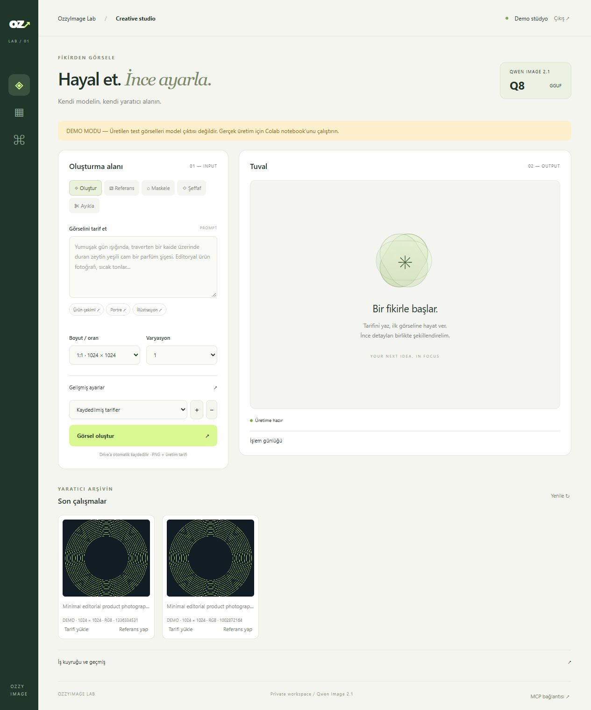

# OzzyImage Lab

Qwen-Image-2.1 **Q8_0 GGUF** için Colab üzerinde çalışan kişisel görsel stüdyosu.
Model dosyaları ve çalışmalar Google Drive'da saklanır; web arayüzü ve MCP aynı ngrok tünelini kullanır.



## Hızlı başlangıç

1. Bu klasörün kaynak dosyalarını kendi GitHub deponuza yükleyin. `data/`, `runtime/`, `.research/`, anahtarlar ve model dosyaları repoya dahil edilmez.
2. `notebooks/OzzyImage_Lab.ipynb` dosyasını Colab'da açın.
3. GPU çalışma zamanı olarak **A100** seçin; Drive'ı bağlayın.
4. Notebook'ta `REPO_URL` alanına kendi depo adresinizi yazın. `REVISION` bir branch, tag veya commit olabilir; tekrarlanabilir kurulum için tam commit SHA kullanın.
5. Colab Secrets'a `NGROK_AUTHTOKEN` ve en az 24 karakterlik, rastgele üretilmiş `OZZY_TOKEN` ekleyin. Gerekirse `HF_TOKEN` ekleyin. Notebook'a erişim izni verin.
6. Kurulum hücrelerini sırayla çalıştırın. İlk seferde model indirmeleri ve CUDA derlemesi zaman alır.
7. Notebook'un verdiği HTTPS adresini açın ve erişim anahtarını girin.

**Doğrulama durumu:** API/MCP ve depolama testleri CPU üzerinde demo motoruyla çalıştırılmıştır. Gerçek Q8 CUDA çıkarımı, A100 bellek tüketimi ve çıktı kalitesi henüz ölçülmemiştir. Notebook'un isteğe bağlı GPU kabul testi beş çalışma modunu gerçek motorla sınar; ilk kullanımdan önce çalıştırılması önerilir.

## Stüdyo

| Özellik | Uygulama |
| --- | --- |
| Metinden üretim | Q8 denoiser, Euler, adım/CFG/negatif prompt/seed ayarları |
| Referanslı düzenleme | Sıralı 1–10 referans; Qwen3-VL vision projector dahil |
| Bölgesel düzenleme | Fırça, silgi, geri alma, maske yükleme, kenar yumuşatma |
| Maske dışını koruma | Model çıktısını kaynakla beyaz/siyah maske üzerinden birleştirme |
| Şeffaf üretim | Modelin RGBA prompt biçimi ve dört kanallı VAE çıktısı |
| Konu ayıklama | Referans + şeffaflık yönergesi; sonuçta alpha varlığı kaydedilir |
| Galeri | PNG, gerçek seed, boyut ve üretim tarifleri; çıktıyı referans olarak kullanma |
| Tarifler | Drive'a kaydetme, yükleme, silme; UI ve MCP erişimi |
| İş kuyruğu | Tek GPU işi, 1–8 sıralı varyasyon, iptal, motor günlüğü |
| Kalıcılık | Drive üzerinde iş kayıtları, referanslar, maskeler ve PNG + JSON |
| MCP | Streamable HTTP; 12 araç; web API ile ortak iş kuyruğu |

Maskeleme, ayrı bir native inpainting ağı veya native mask-conditioning uygulaması değildir.
İlk referansta seçili bölge kırmızıyla işaretlenerek modele verilir. `preserve_unmasked=true`
ise sonuç özgün görsele birleştirilir. Beyaz alan düzenlenir; siyah alan korunur.
`mask_blur=0` siyah alan piksellerini birebir korur. Yumuşatma etkinse sınırın çevresi de harmanlanır.
Bu modda birleştirilmiş sonuç **ilk referansın özgün boyutundadır**; seçilen üretim boyutu modelin çalışma çözünürlüğüdür.

Şeffaf görseller için arayüz yönergesi otomatik genişletilir. Modelin gerçekten saydam piksel üretmesi
prompt'a bağlıdır; galeri yalnızca alpha kanalında saydamlık bulunduğunda RGBA etiketi gösterir.
Şeffaf bir referansı düzenlemek için Referans moduna PNG yükleyip saydamlığı koruma yönergesi yazabilirsiniz.

**Kapsam sınırı:** Qwen Image Layered farklı bir modeldir; bu modelde katman ayrıştırma seçeneği sunulmaz.
Uyumluluğu doğrulanmış Qwen 2.1 LoRA/ControlNet ağırlıkları bu projeye dahil değildir; bu özellikler
`capabilities` çıktısında kapalıdır. Turbo farklı ağırlık ve örnekleme tarifi gerektirir; burada standart 2.1 Q8 kullanılır.
Bu sürüm kullanıcı isteğine dayalı oluşturma/düzenleme akışlarını kapsar; model ailesindeki her başka modelin özelliğini kapsadığı iddia edilmez.

## GPU ve depolama

Varsayılan kurulum:

- `unsloth/Qwen-Image-2.1-GGUF/qwen-image-2.1-Q8_0.gguf`
- `unsloth/Qwen3-VL-8B-Instruct-GGUF/Qwen3-VL-8B-Instruct-Q8_0.gguf`
- `unsloth/Qwen3-VL-8B-Instruct-GGUF/mmproj-F16.gguf`
- `unsloth/Qwen-Image-2.1-FP8/vae/qwen_image_2.1_vae_bf16.safetensors`

VAE deposunun adında FP8 bulunması denoiser'ın FP8 olduğu anlamına gelmez; yalnızca BF16 VAE alınır.
Denoiser her iki profilde de Q8'dir. Bellek tasarrufu için yalnızca encoder `UD-Q4_K_XL` seçilebilir.

| Profil | Başlangıç | Kullanım |
| --- | --- | --- |
| A100 40 GB | 1024², batch 1, offload + VAE tiling | Önce tek referansla çalıştırın, ardından boyut/referans sayısını artırın |
| A100 80 GB | Aynı güvenli başlangıç | 2K presetler ve çoklu referans için daha geniş bellek payı; offload arayüzden kapatılabilir |

Profiller ölçülmüş VRAM garantisi değildir. Kod GPU belleğini denetler; 80 GB profili 40 GB GPU'da başlatılmaz.
Her iki profil aynı Q8 kalite ayarlarını korur, 80 GB seçimi çözünürlüğü sessizce yükseltmez.
Colab GPU erişimi aboneliğe ve anlık kullanılabilirliğe bağlıdır; notebook belirli bir GPU tahsisini garanti etmez.
Drive'da modeller ve ilk çıktılar için en az **30 GB boş alan** ayırın; galeri büyüdükçe artırın.
Derleme yerel `/content` diskinde yapılır. Offload sistem RAM'ini kullanır ve üretimi yavaşlatabilir.

Motor her varyasyonda ayrı süreçte çalışır; iptal ve GPU belleğini geri verme basittir, ancak model tekrar yüklenir.
Bu nedenle sıcak model sunucusuna göre ardışık üretim gecikmesi yüksektir. İlk sürüm dayanıklı tek kullanıcı akışını önceler.
Drive doğrudan model okuması da yerel SSD'den yavaş olabilir.

## Checkpoint ve güncelleme

Notebook 8. hücre:

- `check`: uzak sürümü alır, mevcut/hedef SHA gösterir; çalışma dosyalarını değiştirmez.
- `update`: mevcut kaynak kodunu `checkpoints/<SHA>.bundle` içine kaydeder, sonra hedef SHA'ya geçer.
- `rollback`: Drive'daki bundle'ı doğrular, belirtilen 40 karakterli SHA'ya döner.

Yerel değişiklik varsa güncelleme/geri dönüş durur. Sunucu önce durdurulmalı; ardından bağımlılık,
model/motor kurulumu ve başlatma hücreleri yeniden çalıştırılmalıdır.
Bu işlem kaynak kodunu geri alır; Python ortamı için her kurulumda paket listesi kaydedilir ama tam bir VM snapshot'ı alınmaz.
Model revision'ları ilk indirmede `model-lock.json` içine sabitlenir ve tekrar kullanılır.
SHA256 ilk indirmede hesaplanır; `VERIFY_WEIGHTS` ile tekrar doğrulanabilir. İlk indirme bozulursa Hugging Face indirme hatası gösterir.

Bir oturum kesilirse bitmiş görüntüler korunur; sıradaki/çalışan işler yeniden açılışta `interrupted` olur.
Yarım diffusion süreci devam etmez. Galeride bitmiş çıktının tarifi yüklenebilir; kesilen işin isteği MCP `get_job` veya Drive JSON kaydından yeniden gönderilebilir.

## MCP

Adres: `https://<ngrok-host>/mcp/`

Transport: **Streamable HTTP**. Her istekte:

```text
Authorization: Bearer <OZZY_TOKEN>
```

Araçlar: `capabilities`, `upload_image`, `generate_image`, `get_job`, `list_jobs`, `cancel_job`,
`get_image`, `get_recipe`, `reuse_output`, `save_preset`, `list_presets`, `delete_preset`.

`generate_image` aynı `Generation` şemasını kullanır; `mode` alanı `generate`, `edit`, `mask`,
`transparent` veya `extract` olabilir. Örnek araç argümanları:

```json
{"settings":{"mode":"generate","prompt":"A ceramic mug, soft daylight","width":1024,"height":1024,"steps":20,"cfg":6,"seed":42}}
```

Referans ve maske için `upload_image` aracına data-URL öneki olmayan base64 gönderin;
dönen kimlikleri `references` ve `mask` alanlarında kullanın. Görseller URL üzerinden indirilmez;
sunucu uzak URL veya keyfi yerel dosya yolu kabul etmez. Üretim isteği iş kimliği döndürür;
`get_job` ile takip edin, `get_image` ile görsel içeriğini alın. Örnek Python istemcisi `examples/mcp_client.py`.

Bearer başlığı ayarlayabilen istemciler desteklenir. OAuth zorunlu istemciler için OAuth sağlayıcısı bu sürümde yoktur.
Sunucuyu tek Uvicorn worker ile çalıştırın. Birden çok worker GPU kuyruğunu paylaşmaz.

## Yerel demo ve testler

Python 3.11+:

```bash
pip install -e '.[test]'
pytest -q
```

PowerShell:

```powershell
$env:OZZY_DEMO='1'
$env:OZZY_TOKEN='replace-with-a-long-random-local-test-key'
python -m uvicorn ozzy.app:create_app --factory --host 127.0.0.1 --port 8000
```

Demo yalnızca test çizimleri üretir; gerçek modele bağlanmaz. Linux/macOS için aynı değişkenleri `export` ile ayarlayın.
Gerçek sunucu için `OZZY_DEMO` değişkenini kaldırın, `OZZY_CONFIG` dosyasını ve `OZZY_DATA` klasörünü belirtin.
GPU kabul testi: `python scripts/smoke_gpu.py --config /content/ozzy-runtime/config.json --data /content/drive/MyDrive/OzzyImage-Lab`.

## Mimari ve dosyalar

```text
notebooks/OzzyImage_Lab.ipynb   Colab başlangıç noktası
ozzy/app.py                   FastAPI, oturum doğrulama, MCP araçları
ozzy/schema.py                Ortak üretim parametreleri
ozzy/service.py               Tek GPU kuyruğu, iptal, kalıcı kayıtlar
ozzy/engine.py                Qwen 2.1 sd-cli adaptörü
ozzy/storage.py               Görsel doğrulama, maske birleştirme
ozzy/static/                  Web Studio ve maske tuvali
scripts/setup_colab.py        Model indirme, SHA256, CUDA derlemesi
scripts/checkpoint.py         Kaynak snapshot ve geri dönüş
scripts/smoke_gpu.py          Gerçek GPU kabul testi
tests/                        CPU üzerinde uygulama testleri
```

Web oturumu HttpOnly/SameSite cookie, API/MCP Bearer anahtarı kullanır. PNG ve JSON dosyaları da yetkilendirme arkasındadır.
Bu tek kullanıcılı kişisel bir stüdyodur; çok kiracılı servis değildir. Drive'daki referanslar/çıktılar kalıcıdır;
anahtarlar Drive'a veya notebook çıktısına yazılmaz. Sunucu token'ını paylaşan istemci tüm stüdyoya erişir.

## Lisans ve kaynaklar

Proje kodu MIT lisanslıdır. Model ağırlıkları bu depoda dağıtılmaz ve proje lisansına dahil değildir.
[Qwen model kartı ve lisansı](https://huggingface.co/Qwen/Qwen-Image-2.1),
[Unsloth Q8 dosyaları](https://huggingface.co/unsloth/Qwen-Image-2.1-GGUF),
[Unsloth çalışma rehberi](https://unsloth.ai/docs/models/qwen-image-2.1),
[stable-diffusion.cpp](https://github.com/leejet/stable-diffusion.cpp),
[MCP Python SDK](https://github.com/modelcontextprotocol/python-sdk/tree/v1.26.0).

Motor `fd21ecfceef2665d2c5f2db8536e3202d864fd30` commit'ine sabitlenmiştir. Bu sürümün
Qwen 2.1 düzenleme ve RGBA yolları kaynak kodundan doğrulanmıştır; GPU çalışma doğrulaması ayrıca gereklidir.
